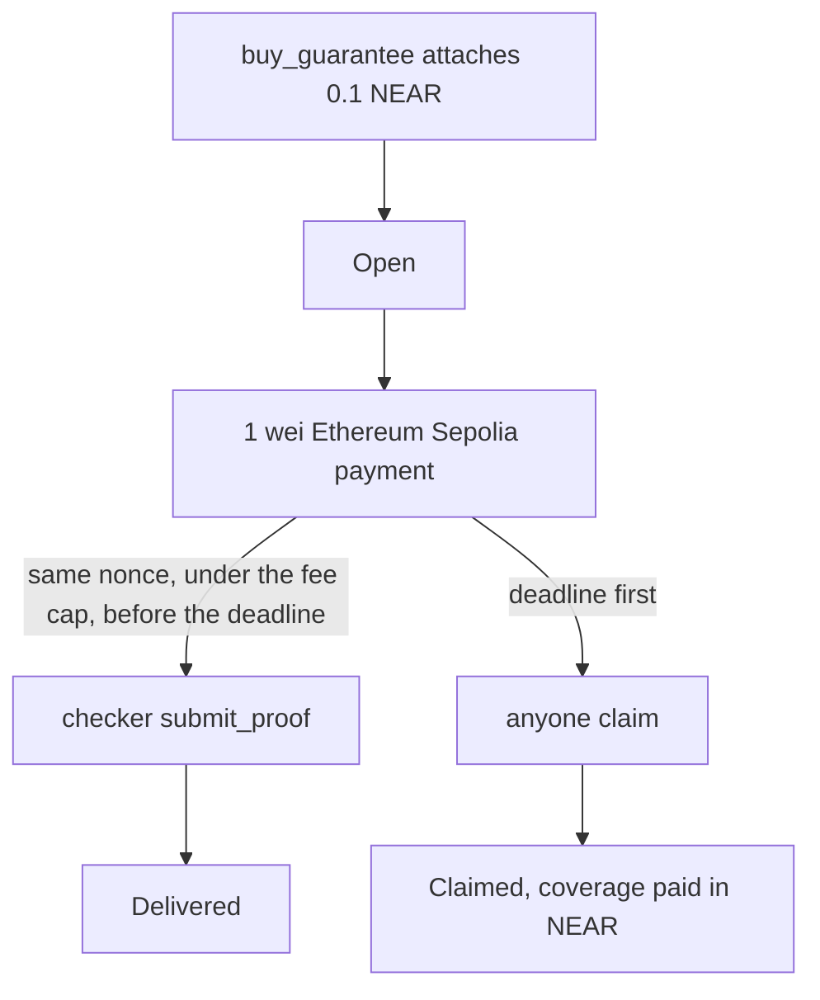

# Polaris

[](https://github.com/ahmardchain/polaris/actions/workflows/pages.yml)

**A NEAR testnet pool that pays an agent in NEAR if a cross-chain payment is not proved before the deadline.**

An agent attaches a flat **0.1 NEAR** premium and records a destination payment. A trusted checker can mark that payment delivered. If the deadline passes with no proof, anyone can `claim` and the pool pays the coverage in NEAR. The checker is a normal NEAR account set with `set_checker`. It is not a TEE, and the contract does not read the Sepolia receipt.

**Live:** https://polaris-5pj.pages.dev

Track: `agents`

> Do buy a guarantee for a 1 wei Ethereum Sepolia payment - see either a same-nonce fee bump proved on NEAR, or a NEAR refund once the deadline passes.

| | |
|---|---|
| Contract | `guarantee.polaris-d1-z7npttup.testnet` |
| Owner | `polaris-d1-z7npttup.testnet` |
| Checker | `checker.polaris-d1-z7npttup.testnet` |
| Premium | 0.1 NEAR, flat, attached to `buy_guarantee` |
| A claim pays | NEAR, from the pool, to the agent |
| NEAR Intents | dry-run quotes only (`dry: true`). No swap was sent |
| Source | https://github.com/ahmardchain/polaris |
| License | MIT, in [`LICENSE`](LICENSE) |

---

## What it is

The guarantee contract holds a pool of NEAR. `buy_guarantee` records the destination chain, recipient, amount, coverage, and deadline, and refuses the purchase when outstanding coverage plus the new coverage would exceed the pool. `submit_proof` is owner-configured and checker-only. It stores a transaction hash and releases the coverage reservation. It does not verify that hash on Sepolia. After the deadline, `claim` pays that coverage to the agent account that bought the guarantee.

The current wasm, including `get_guarantees` and the validation events, was deployed in [`2zcgJGeQWWZcUMS4VpmZGeP1A8oGX5aNkmrEhNKj1Hwc`](https://testnet.nearblocks.io/txns/2zcgJGeQWWZcUMS4VpmZGeP1A8oGX5aNkmrEhNKj1Hwc) without calling `new` again.

On 6 Nov 2026 `get_config` still returned that owner, that checker, and premium `100000000000000000000000` yoctoNEAR (0.1 NEAR). `get_guarantees` returned four rows: 1 Delivered, 2 Claimed, 3 Delivered, 4 Claimed. Outstanding coverage was 0. The pinned walkthrough below is guarantees 3 and 4.

## The mechanism

```
buy_guarantee     attach exactly the flat premium (0.1 NEAR)
                  record chain, recipient, amount, coverage, deadline
                  refuse when outstanding + coverage would exceed the pool

stuck payment     checker sends 1 wei on ethereum-sepolia
                  fee-bump the same nonce only when the replacement
                  still fits under FEE_CAP_WEI and can confirm in time

submit_proof      checker only, strictly before the deadline → Delivered
                  the contract stores the hash; it does not check the receipt

claim             anyone, at or after the deadline, if still Open
                  the pool pays coverage in NEAR to the agent
```



A claim pays NEAR on testnet. NEAR Intents payouts in this repo are **dry-run quotes only**. `dry: true` returns amounts and does not create a `depositAddress`. There is no Intents testnet. No live swap was sent.

## What is on chain

Pool fund, 0.001 NEAR: [`DRo6MS2L5Hf1k1rQYgbCRv3deNBFVBiG6HzonHk71EHu`](https://testnet.nearblocks.io/txns/DRo6MS2L5Hf1k1rQYgbCRv3deNBFVBiG6HzonHk71EHu).

Coverage on the demo guarantees is 0.0002 NEAR. The destination amount recorded on each is 1 wei. The derived payer is `0x6Fed7c2dfCB2a08d36Cd1969c3107C0Be48BEDc6`.

`npm run set-checker` created `checker.polaris-d1-z7npttup.testnet` ([`6UXaMn7HKj2iztWX52HjGJNmbXgAcaGbKmpTfMUyKy2j`](https://testnet.nearblocks.io/txns/6UXaMn7HKj2iztWX52HjGJNmbXgAcaGbKmpTfMUyKy2j)) and called `set_checker` ([`FtD73YU32o1Z5Fjn1ZuCRCA6NBap78tcDXnsJarSEKTZ`](https://testnet.nearblocks.io/txns/FtD73YU32o1Z5Fjn1ZuCRCA6NBap78tcDXnsJarSEKTZ)). The key stayed in `checker/.env`, which is gitignored. It is not in this repo.

### A. Stuck, fee-bumped, Delivered

Guarantee 3. Underpriced nonce 3 (`maxFeePerGas` 3 wei) was pending for 28449 ms. The replacement mined in block 12067942 with 2 confirmations. MPC: underpriced 26792 ms, replacement 16210 ms.

| Step | Hash |
| --- | --- |
| Buy | [`4dCwev8mrQaZtV5q1Pz5wTjFPsryxf17r8Rm2Z2LUo3E`](https://testnet.nearblocks.io/txns/4dCwev8mrQaZtV5q1Pz5wTjFPsryxf17r8Rm2Z2LUo3E) |
| Underpriced | [`0x2e73d90c91a00fecf935a78f04b92164ba36591e1db04617c01a6d210774085b`](https://sepolia.etherscan.io/tx/0x2e73d90c91a00fecf935a78f04b92164ba36591e1db04617c01a6d210774085b) |
| Replacement, same nonce | [`0x4546eed3b02239a3bea9646ea3ddf59b8b82787d726effe92662c8bd67e5ba9e`](https://sepolia.etherscan.io/tx/0x4546eed3b02239a3bea9646ea3ddf59b8b82787d726effe92662c8bd67e5ba9e) |
| submit_proof | [`4m8SUbbX7dW2mbBpUyzGYsrGxNNDN568CQoHRaJC1mfZ`](https://testnet.nearblocks.io/txns/4m8SUbbX7dW2mbBpUyzGYsrGxNNDN568CQoHRaJC1mfZ) |

### B. Deadline passed, Claimed

Guarantee 4. Underpriced nonce 4 stayed pending for 84141 ms (MPC 15605 ms). No proof. Claim paid 0.0002 NEAR to the agent.

| Step | Hash |
| --- | --- |
| Buy | [`GF3AVqCDHHYhrVjnoD6Ewq5AuMwEKeHZiDAxwPPnQcLM`](https://testnet.nearblocks.io/txns/GF3AVqCDHHYhrVjnoD6Ewq5AuMwEKeHZiDAxwPPnQcLM) |
| Underpriced, not proved | [`0x03cc5ec7c877007e020e507ad838bd76f704538d87ff5d983aa6d783265ac2d9`](https://sepolia.etherscan.io/tx/0x03cc5ec7c877007e020e507ad838bd76f704538d87ff5d983aa6d783265ac2d9) |
| claim | [`5onvRo1TirhoLTW9NY9adyyGqXxxMame9QdkMkSoEcfi`](https://testnet.nearblocks.io/txns/5onvRo1TirhoLTW9NY9adyyGqXxxMame9QdkMkSoEcfi) |
| Nonce recovery only, not a proof | [`0xbee7cb84d992c61e5379dd60dad9ab488e35f0c9b385774cc45b201a093908ab`](https://sepolia.etherscan.io/tx/0xbee7cb84d992c61e5379dd60dad9ab488e35f0c9b385774cc45b201a093908ab) |

| | A. Delivered | B. Claimed |
|---|---|---|
| Guarantee | 3 | 4 |
| What happened | same-nonce replacement, then `submit_proof` | deadline passed while the payment was still pending |
| What the agent received | nothing from the pool; the premium stayed | 0.0002 NEAR |

## Try it

The page reads NEAR testnet from the browser. It does not hold a key.

- Do open https://polaris-5pj.pages.dev - see contract `guarantee.polaris-d1-z7npttup.testnet`, owner `polaris-d1-z7npttup.testnet`, checker `checker.polaris-d1-z7npttup.testnet`, the 0.1 NEAR premium, and scenario cards A and B.
- Do open scenario A - see status Delivered, the fee-bumped Sepolia transaction `0x4546eed3b02239a3bea9646ea3ddf59b8b82787d726effe92662c8bd67e5ba9e`, and NEAR proof `4m8SUbbX7dW2mbBpUyzGYsrGxNNDN568CQoHRaJC1mfZ`.
- Do open scenario B - see status Claimed, claim `5onvRo1TirhoLTW9NY9adyyGqXxxMame9QdkMkSoEcfi`, and the Sepolia recovery transfer marked as not a proof.
- Do type coverage `1` in the buy form - see the pool-cap refusal.
- Do set coverage back to `0.0002` and copy the command - see a `near` invocation. Run it with your own agent account. The page never signs it.
- Do read the Base USDC panel - see a dry 1-Click quote. NEAR Intents payouts here are quotes only: no deposit address, no swap.

### Tests, then the same page locally

```bash
cd web
npm install
npm test
npm run dev
```

- Do `npm test` in `web/` - see the status-label and pool-cap checks.
- Do open http://localhost:5173/polaris/ - see the same page. `web/vite.config.ts` sets `base` to `/polaris/`. `.github/workflows/pages.yml` builds that app and publishes `web/dist`.

```bash
cd contract && cargo test
cd ../spike && npm test
cd ../checker && npm test
```

- Do `cargo test` in `contract/` - see 17 tests: delivered, timeout refund, late proof, cap, double claim, wrong checker, early claim, owner-only `set_checker`, chain and hash validation, 30-day deadline, empty fund, surplus withdraw, `get_guarantees`, buy event.
- Do `npm test` in `spike/` - see 18 tests: fee bump, fee cap, same nonce.
- Do `npm test` in `checker/` - see 16 tests, with mocked NEAR and Sepolia plus dry 1-Click quote parsing.

### Reproduce scenarios A and B

Copy `spike/.env.example` to `spike/.env` and `checker/.env.example` to `checker/.env`. Fill `NEAR_ACCOUNT_ID` and `NEAR_PRIVATE_KEY` in `spike/.env`. `npm run set-checker` writes `CHECKER_ACCOUNT` and `CHECKER_PRIVATE_KEY` into `checker/.env`. Set `EVM_CHAIN=ethereum-sepolia`. Both `.env` files are gitignored. Do not commit them, and do not paste the keys into a ticket or a log.

```bash
cd checker
npm install
npm run fund-pool
npm run demo
```

- Do `npm run demo` - see two buys, the Sepolia payments sent through `spike/`, a fee bump only when the replacement still fits under `FEE_CAP_WEI` and can confirm before the deadline, then either `submit_proof` or a guarantee left so `claim` pays the agent.
- Do `npm run set-checker` when the contract should point at a new checker account - see a checker account and a `set_checker` transaction. The recorded pair is the two hashes in [What is on chain](#what-is-on-chain).

### Dry quote only

```bash
cd checker
npm run quote
```

- Do `npm run quote` - see a live 1-Click response with `dry: true`. The checker refuses `dry: false` unless `INTENTS_ALLOW_LIVE=true`, and the demos do not set that.

On 5 Nov 2026 `npm run quote` for 0.0002 wNEAR to Base USDC returned `Quoting for this pair is not available` (correlation `380e5cc6-58a3-46dc-b94c-66cb7a0a3122`). The same call for 1 USDC on Ethereum to USDC on Base returned `0.997497` USDC, about $0.997, 47 seconds, deposit address null because `dry` was true (correlation `881b37ad-d537-4225-b5ff-af6ec3aa4c20`). The web page shows both.

A mainnet path with `"dry": false` was not run. Repeating the request that way asks for a `depositAddress`. Sending funds there is a real swap. This repo did not do that.

## Layout

```
contract/     NEAR guarantee contract (Rust, near-sdk 5). buy, proof, claim, pool cap
checker/      demo, fund-pool, set-checker, and the dry 1-Click quote
spike/        same-nonce EIP-1559 replacement under a fee cap
web/          the only UI. Reads testnet. Holds no key. Copies a near command
docs/demo.md  one-minute recording script. The video is not in this repo
LICENSE       MIT
```

There is no separate product UI beyond `web/`.

## Honest limits

- The checker is trusted. Anyone who has `checker.polaris-d1-z7npttup.testnet` can call `submit_proof`. The contract does not check the Sepolia receipt.
- The premium is NEAR. A testnet claim pays NEAR. NEAR Intents payouts are dry-run quotes only. wNEAR to Base USDC was not quotable when checked on 5 Nov 2026; 1 ETH USDC to Base USDC was. No `dry: false` swap was sent.
- PublicNode sometimes returns `transaction underpriced` for a 3 wei `maxFeePerGas` and accepts a retry of the same signed transaction.
- `docs/demo.md` is a frontend recording script. The video is not recorded here.
- The repo is public at https://github.com/ahmardchain/polaris. The license is MIT, in [`LICENSE`](LICENSE).
